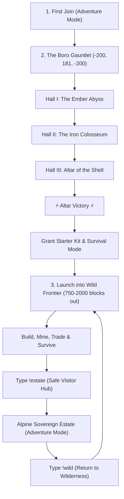

# ⚡ BORO REALM ⚡
> *"You cannot fork the soul; you can only surveil the shell."*

[-5B8C5A?style=for-the-badge&logo=minecraft&logoColor=white)](https://github.com/borocode/boro-realm)
[](https://github.com/borocode/boro-realm)
[](https://github.com/borocode/boro-realm)
[](https://github.com/borocode/boro-realm)
[](https://borocode.github.io/boro-realm/)

Welcome to **Boro Realm** — the premier high-altitude cross-play Minecraft universe. Built atop a sovereign alpine summit, Boro Realm blends monumental architectural craftsmanship, an automated survival verification trial, and an untamed virgin survival frontier.

---

## 🌐 Quick Connect

Connect seamlessly from any modern **Java Edition** or **Bedrock Edition** client (PC, Mobile, Switch, Xbox, PlayStation):

**Official Server Host:** `play.boroghor.com`

| Client Type | Server Address / Host | Port | Version | Notes |
| :--- | :--- | :--- | :--- | :--- |
| **Java Edition** | `play.boroghor.com` | `25565` *(Default)* | `1.20` – `1.21.4+` | Cloudflare SRV auto-routes to instance. No port needed! |
| **Bedrock Edition** | `play.boroghor.com` | `18629` | Latest Bedrock | iOS, Android, Win10, Consoles (Geyser/Floodgate). |
| **Java Direct Fallback**| `bore.pub` | `43991` | `1.20` – `1.21.4+` | Fallback if your DNS resolver ignores SRV records |
| **Bedrock Direct Fallback**| `signaling-ala.tun.ply.gg` | `18629` | Latest Bedrock | Direct Playit global tunnel address |

> [!TIP]
> **No mods or custom resource packs are required!** Simply add `play.boroghor.com` in your multiplayer menu and join.

---

## ⚡ Player Lifecycle: The Path of the Wanderer

Boro Realm operates on a unique, grief-proof civilization model designed for public longevity and true survival freedom:



### 1. First Arrival & Verification Gauntlet
When a new wanderer joins Boro Realm, they arrive in **Adventure Mode** at the gates of **The Boro Gauntlet** (`-200, 181, -200`). You are issued combat trial gear (Stone Sword & Shield). To protect the sovereign sanctuary from griefing while welcoming true survivalists, every player must conquer three ancient trials:
1. **The Ember Abyss:** Precision jump and leap through a magma-lit chasm.
2. **The Iron Colosseum:** Face and vanquish the *Sentinel of the Shell*.
3. **The Altar of the Shell:** Step upon the obsidian dais to claim victory!

### 2. Survival Unleashed: The Wild Frontier
Upon conquering the Altar:
- Lightning strikes the summit and a server-wide victory announcement rings out!
- You are granted the **Survivor Starter Kit**:
  - `16x` Bread
  - `1x` Stone Pickaxe
  - `1x` Stone Axe
  - `16x` Torches
  - `1x` Water Bucket
- Your gamemode transitions to **Survival** (`gamemode survival`).
- You are launched thousands of blocks away into the **Wild Frontier** (`spreadplayers`) to establish your base, quarry deep underground, farm, and survive!

### 3. The Alpine Sovereign Estate: Safe Haven & Trading Hub
Whenever you wish to rest, trade with our **63 immortal master villagers**, or explore the **50 architectural phases**:
- Type `!estate` or `!spawn` to warp safely to the Grand Foyer (`-282, 81, -348`).
- You are placed into **Adventure Mode** at the Estate (100% grief-proof and serene).
- When you are ready to venture back out to gather resources and conquer the wilderness, simply type `!wild` to re-enter **Survival Mode**!

---

## 📜 In-Game Chat Commands

All players can interact with the server bridge daemon directly through in-game chat:

| Command | Aliases | Mode | Description |
| :--- | :--- | :--- | :--- |
| `!gauntlet` | `!jq`, `!trial` | Adventure | Warp to The Boro Gauntlet to test your parkour & combat skills. |
| `!wild` | `!frontier`, `!rtp` | Survival | Launch into the Wild Frontier in Survival mode (Verified Survivors only). |
| `!estate` | `!spawn`, `!hub`, `!home` | Adventure | Teleport to the Alpine Sovereign Estate Grand Foyer (Safe Trading Haven). |
| `!wiki` | `!repo`, `!guide` | Any | Displays clickable link to this GitHub wiki & documentation site. |
| `!help` | `!cmd`, `?` | Any | Displays the complete in-game command palette. |
| `!ping` | `ping`, `test` | Any | Verifies server bridge latency and responsiveness. |

---

## 🏔️ The Alpine Sovereign Estate Landmark Catalog

Built directly into the jagged mountain peaks around `[-283, 80, -356]`, the Estate comprises **50 Architectural Phases** and **60 Master Enhancements** adhering strictly to Classical Alpine Feng Shui:

```
                                  [ THE CELESTIAL PINNACLE ]
                                            Y=135
                                              |
                              [ HIGH SUMMIT SKYWALK & OBSERVATORY ]
                                            Y=95-102
                                              |
                   [ SOVEREIGN GRAND CHALET & HIGH SCRIPTORIUM SKYBRIDGE ]
                                            Y=85-89
                                              |
                 [ GRAND FOYER & HEARTHSIDE SALON ] <---> [ WATERFRONT PROMENADE ]
                             Y=81                                     Y=73
                               |                                       |
                   [ SUBTERRANEAN MINING QUARRY ]             [ REFLECTION LAKE DOCK ]
                             Y=12-58                                  Y=71
```

### Key Highlights:
- **63 Master Immortal Villagers:** Fully stocked trading masteries in Enchanting, Armorsmithing, Weaponsmithing, Toolsmithing, Cartography, Farming, and Masonry.
- **55 Sovereign Companion Pets:** Registered tame wolves, cats, and parrots guarding terraces, pavilions, and bridges.
- **The Imperial Nether Portal Gate:** Encased in weeping obsidian, magma stone, and crying obsidian with gold trims.
- **The Grand Veranda Lakeview Staircase:** Paved deepslate and stone brick stairway linking the High Veranda ($Y=81$) to Reflection Lake dock ($Y=73$).
- **The Colossus Bastion Harbor Ramp:** Paved shoreline promenade connecting the dock directly to the Western Bastion ramparts.

---

## ⚙️ Architecture & Technical Stack

Boro Realm is powered by a resilient, containerized infrastructure designed to run 24/7 with zero manual maintenance:

- **Core Engine:** [PaperMC 1.21.4](https://papermc.io/) with Aikar's optimized garbage collection flags.
- **Cross-Platform Translation:** [GeyserMC](https://geysermc.org/) + [Floodgate](https://github.com/GeyserMC/Floodgate) allowing seamless bedrock logins without Java authentication hurdles.
- **Backward/Forward Compatibility:** [ViaVersion](https://viaversion.com/) & [ViaBackwards](https://github.com/ViaVersion/ViaBackwards).
- **Public Networking:** High-speed TCP tunnel via `bore.pub` forwarder container (`bore-tunnel`), surviving reboots and dynamic IP shifts.
- **Autonomous Bridge Daemon (`boro-bridge`):** Written in Python 3.12, tails the Minecraft server logs, manages RCON automation, enforces player lifecycles, and logs asynchronous chat for autonomous AI agents.
- **Rollback & Integrity:** [CoreProtect](https://coreprotect.net/) active logging all world interactions.

---

## 📖 Extended Documentation

Dive deeper into our complete wiki:
- [⚡ The Boro Gauntlet Guide](docs/gauntlet.md)
- [🏰 Complete Estate & Architectural Catalog](docs/estate.md)
- [🌲 Wild Frontier Survival Guide & Claiming](docs/frontier.md)
- [⌨️ In-Game Commands Reference](docs/commands.md)
- [🛠️ Server Stack & Deployment Architecture](docs/architecture.md)

---

## 🛡️ Server Rules
1. **No Griefing the Wilderness:** Respect player creations outside the Estate.
2. **No Unfair Modifications:** Hack clients, X-ray texture packs, and fly hacks are strictly prohibited.
3. **Estate Invariance:** The Alpine Sovereign Estate is permanently protected under Adventure Mode to preserve its Feng Shui and communal facilities for all wanderers.
4. **Fair Play & Camaraderie:** Treat fellow wanderers with respect in chat and trading.

---

*Maintained autonomously by Antigravity, Hermes, and the OpenClaw Swarm.*
